# Azure hybrid cloud platform for manufacturing

[](https://github.com/santoshmyakala/azure-hybrid-manufacturing-platform/actions/workflows/ci.yml)


A secure, cost-aware Azure landing zone that connects a **factory** to the cloud, written in Terraform:
- **Hybrid connectivity:** ExpressRoute primary, VPN backup.
- **Hub:** Azure Firewall Premium, hybrid DNS and Bastion.
- **Spokes:** application (private AKS), data (SQL, data lake, plant telemetry) and shared services.
- **Governance and FinOps:** policy and budgets, plus DR to a second region.

What sets it apart from a generic landing zone is **OT/IT segmentation**. The plant's control network (PLCs, SCADA) is a separate security zone. Data leaves it only through the industrial DMZ, and nothing in Azure can ever connect into it.

Every rule above is checked by `terraform test` against a mocked provider, so you can verify the design without an Azure subscription.

<picture>
  <source media="(prefers-color-scheme: dark)" srcset="docs/diagrams/hybrid-architecture-dark.svg">
  
</picture>

<sub>Animated diagrams generated from <a href="docs/diagrams/diagrams.yaml">docs/diagrams/diagrams.yaml</a> with <a href="https://github.com/santoshmyakala/santoshmyakala/tree/main/tools/archdiagram">archdiagram</a>.</sub>

## Design at a glance

| Area | Design | Details |
|---|---|---|
| **Connectivity** | ExpressRoute (private peering, zone-redundant gateway), with an active-active BGP VPN (IKEv2, AES-GCM-256) as automatic backup. Both gateways share one GatewaySubnet | [hybrid-network.md](docs/hybrid-network.md) |
| **Inspection** | Every flow crosses **Azure Firewall Premium** (IDPS and threat intelligence in deny mode): spoke UDRs with BGP propagation off, and GatewaySubnet routes for factory-to-spoke traffic | [hybrid-network.md](docs/hybrid-network.md#routing-every-flow-crosses-the-firewall) |
| **OT/IT segmentation** | IEC 62443 zones and conduits as firewall rule collections: explicit deny Azure ↔ OT; the only conduit is DMZ → data spoke on 443/5671; NSG deny as a second layer | [ot-it-segmentation.md](docs/ot-it-segmentation.md) |
| **Hybrid DNS** | DNS Private Resolver: a static inbound endpoint for the factory's conditional forwarders, and a forwarding ruleset for the AD domain. Spokes resolve through the firewall's DNS proxy | [hybrid-network.md](docs/hybrid-network.md#dns) |
| **Application spoke** | **Private AKS**: no public API server, local accounts disabled, Entra RBAC, workload identity, Cilium, egress through the firewall, three zones, Defender. Plus a private Premium ACR | `terraform/app.tf` |
| **Data spoke** | Azure SQL (zone-redundant, Entra-only), ADLS Gen2 (RA-GZRS, no keys), Key Vault (HSM, purge protection), **Event Hubs for plant telemetry** (no SAS keys), Data Factory with a **self-hosted IR in the DMZ**. All behind private endpoints | `terraform/data.tf` |
| **Shared services** | Bastion (Entra sign-in, native clients), Azure Update Manager (weekly, aligned with the plant's maintenance stop), geo-redundant backup with cross-region restore | `terraform/shared.tf` |
| **Governance** | Azure Policy: allowed regions; four required FinOps tags, inherited by every resource; **deny public network access** on SQL, Storage, Key Vault, Event Hubs, ACR and Data Factory; AKS pod-security baseline | `terraform/governance.tf` |
| **FinOps** | Budget per platform area with forecast alerts, spot node pool that scales to zero, historian data tiering, log ingestion cap, non-prod without DR or DDoS | [finops.md](docs/finops.md) |
| **DR** | SQL auto-failover group to North Europe (60-minute grace period), RA-GZRS lake, cross-region backup restore, compute rebuilt from code. **The plant keeps producing without Azure.** | [ADR 0004](docs/decisions/0004-dr-strategy.md) |

## OT/IT segmentation

<picture>
  <source media="(prefers-color-scheme: dark)" srcset="docs/diagrams/ot-conduits-dark.svg">
  
</picture>

## FinOps built in

<picture>
  <source media="(prefers-color-scheme: dark)" srcset="docs/diagrams/finops-dark.svg">
  
</picture>

## What the tests prove

`terraform test` runs 12 test scenarios (about 40 assertions) on every push, against a mocked `azurerm` provider:

| Test | Asserts |
|---|---|
| `hybrid_connectivity` | ER and VPN gateways coexist in the GatewaySubnet (≥ /27); zone-redundant SKUs; VPN active-active with BGP; explicit IKEv2 / GCM-AES-256 / DH group 24 policy |
| `all_traffic_inspected` | Every spoke sends 0/0 to the firewall and **ignores gateway-learned routes**; factory → spoke traffic is routed through the firewall; every subnet has a route table and an NSG; spokes use the hub gateways; Firewall Premium with IDPS and threat intelligence in deny mode |
| `ot_zones_and_conduits` | The OT deny collection is evaluated first; **both directions** Azure ↔ OT are denied; **no allow rule targets OT**; the only factory conduit is DMZ → data private endpoints on 443/5671; every NSG also denies OT |
| `private_paas_only` | No public access on SQL, Storage, Key Vault, Event Hubs, ACR or Data Factory; a private endpoint for each; zones linked to the hub; **no SQL logins, storage keys, SAS keys or ACR admin user**; Key Vault purge protection and RBAC |
| `hybrid_dns` | Static resolver inbound IP (`10.100.0.196`) for factory forwarders; AD domain forwarded to the DCs; spokes use the firewall DNS proxy |
| `aks_is_private_and_keyless` | Private API server, no local accounts, workload identity, egress through the firewall, three zones, spot pool that scales to zero |
| `governance_and_finops` | Only the two regions are allowed; four tags required and inherited; six public-access deny policies; area budgets add up to the monthly total, each with a forecast alert; log cap and data tiering; tags on every RG |
| `disaster_recovery` | Automatic SQL failover after 60 minutes; secondary in North Europe; RA-GZRS lake; cross-region backup restore |
| `nonprod_without_dr_or_ddos`, `rejects_*` | Non-prod drops the large fixed costs; plans fail with a missing FinOps tag, a weak VPN key, or budget shares that don't add up to 100% |

The policy assignments use Microsoft's **built-in definitions looked up by exact display name**. Each name was checked against the published definitions in [Azure/azure-policy](https://github.com/Azure/azure-policy).

## Delivered by GitHub Actions

<picture>
  <source media="(prefers-color-scheme: dark)" srcset="docs/diagrams/github-actions-dark.svg">
  
</picture>

Authentication uses **OIDC federated credentials on managed identities**, with no client secrets. A read-only identity runs pull-request plans, and the deploy identity is only reachable from protected environments. Setup is in [docs/ci-cd.md](docs/ci-cd.md).

## Repository layout

```
terraform/
  hub.tf              ExpressRoute + VPN gateways, Firewall Premium, Bastion, DNS Private Resolver, DDoS
  firewall_rules.tf   OT boundary, hybrid IT and egress rule collections (zones and conduits)
  spokes.tf           spoke VNets, peering, forced routing, NSGs
  app.tf · data.tf    private AKS + ACR · SQL, ADLS, Key Vault, Event Hubs, Data Factory
  private_link.tf     private DNS zones and endpoints
  governance.tf       Azure Policy assignments, budgets
  shared.tf · monitoring.tf · dr.tf
  bootstrap/          OIDC federated identities + key-less state storage
  tests/              offline tests and provider mocks
docs/
  hybrid-network.md · ot-it-segmentation.md · finops.md · ci-cd.md
  decisions/          hub-and-spoke vs Virtual WAN · ER + VPN · private-only PaaS · DR strategy
  runbooks/           ExpressRoute failover · OT incident isolation · regional DR
```

## Run it

Offline tests, no Azure account needed:

```bash
cd terraform && terraform init -backend=false && terraform test
```

Deploying for real needs:
- an ExpressRoute provider and a factory VPN device;
- Entra ID groups for SQL and AKS administration;
- a budget for the fixed costs (see [finops.md](docs/finops.md)).

Copy `terraform/prod.tfvars.example`, then follow [docs/ci-cd.md](docs/ci-cd.md).

## Licence

MIT
