# CI/CD with GitHub Actions



| Workflow | Trigger | What it does | Needs Azure? |
|---|---|---|---|
| `ci` | every push and PR | `fmt`, `validate`, **12 offline tests** (mocked azurerm), tflint, blocking Trivy IaC scan, gitleaks | No |
| `diagrams` | PRs and pushes touching `docs/diagrams` | Regenerates the SVGs and fails if the committed ones are stale | No |
| `plan` | PR touching `terraform/` | Plans nonprod and prod with the read-only identity, posts one sticky PR comment | Yes |
| `deploy` | push to `main` | nonprod → **approval** → prod. Each stage applies exactly the reviewed plan, then checks ExpressRoute provisioning, connection status and the firewall | Yes |
| `drift` | nightly | Plans both environments, opens, updates or closes a `drift` issue | Yes |

Without Azure configured, `plan` and `deploy` skip and post a notice instead of failing.

## Identity: no client secrets
`terraform/bootstrap` creates two **user-assigned managed identities with federated credentials** for GitHub's OIDC issuer:

| Identity | Federated for GitHub environments | Roles |
|---|---|---|
| `id-github-mfg-plan` | `plan-nonprod`, `plan-prod` (unprotected) | Reader, plus Storage Blob Data Contributor on the state account (for the lock blob) |
| `id-github-mfg-deploy` | `nonprod`, `prod` (protected: `main` only; prod needs reviewers) | Contributor, Resource Policy Contributor, Role Based Access Control Administrator |

A pull request can never run in `nonprod` or `prod`, so it can never get the deploy identity's token. Terraform state is in a storage account with **shared keys disabled**: Entra ID only.

## Enable it
1. **Bootstrap** (as subscription Owner):
   ```bash
   cd terraform/bootstrap && terraform init && terraform apply -var subscription_id=<id>
   ```
   It prints the values for step 3.
2. **Create environments:**
   - `plan-nonprod` and `plan-prod`;
   - `nonprod`: branch `main`;
   - `prod`: branch `main`, plus required reviewers.
3. **Set repository variables:**
   - `AZURE_TENANT_ID`, `AZURE_SUBSCRIPTION_ID`;
   - `AZURE_PLAN_CLIENT_ID`, `AZURE_DEPLOY_CLIENT_ID`;
   - `TF_STATE_RESOURCE_GROUP`, `TF_STATE_STORAGE_ACCOUNT`;
   - `DEPLOY_ENABLED=true`.
4. **Set a `TFVARS` variable on each environment**, using `terraform/prod.tfvars.example` as a template.
5. **Set a repository secret:** `VPN_SHARED_KEY`.
