# FinOps

## Inform: every cost has an owner
- **Four tags are mandatory** on resource groups: `CostCenter`, `Owner`, `Environment` and `Workload`. A policy denies the RG without them. A second policy (`Modify`) copies the tags onto every resource, so nothing in Cost Management is untagged.
- **One resource group per platform area** (connectivity, app, data, shared). Each has its own budget, so showback works without any manual allocation.
- **AKS cost analysis** is on, so cluster cost is split by namespace and team.

## Optimise: forecast before spend
Each area budget, a configurable share of `monthly_budget`, alerts at three points:
- **forecast > 100%**, early, while there's still time to act;
- **actual > 80%**;
- **actual > 100%**, which also notifies the subscription Owner role.

## Levers built into the design

| Lever | Where | Effect |
|---|---|---|
| Spot node pool, scales to 0 | `azurerm_kubernetes_cluster_node_pool.batch_spot` | Interruptible batch (reports, ML scoring) on spot pricing; no cost when idle |
| Cluster autoscaler on every pool | AKS | Capacity follows plant shifts |
| Historian lifecycle: cool after 30 days, archive after 180 | `azurerm_storage_management_policy.lake` | Old sensor data moves to cheaper storage tiers automatically |
| Log Analytics daily cap (20 GB) | `azurerm_log_analytics_workspace.this` | A chatty component can't create a surprise bill |
| ExpressRoute *metered* data plan | `azurerm_express_route_circuit.factory` | Fits modest factory egress; switch to *unlimited* if outbound volume grows |
| Non-prod without DR and DDoS plan | `environment = "nonprod"`, `enable_dr = false`, `ddos_protection = false` | Removes the largest fixed costs outside production |
| Event Hubs auto-inflate with a ceiling | `maximum_throughput_units = 8` | Scales for shift peaks, capped |

## The big fixed costs (review first)
These dominate the monthly bill, whatever the load:
- **DDoS Network Protection plan**: a large fixed monthly fee per plan. Share one plan across all VNets in the tenant, or turn it off for non-production.
- **Azure Firewall Premium**: an hourly charge plus data processed.
- **ExpressRoute circuit** (port + provider) and **both gateways**.
- **Zone-redundant SQL** and the **DR secondary**.

Use the Azure Pricing Calculator for current prices in your region. Prices change, so this repo deliberately doesn't hard-code them.

## Operate
Policy, budgets and the levers above are all code, reviewed in pull requests like any other change. Monthly routine:
1. Act on Azure Advisor cost recommendations.
2. Review reservation and savings-plan coverage for the steady base: system node pool, firewall, SQL.
3. Track cost per plant or line against production volume as the unit metric.
