# OT/IT segmentation (IEC 62443 zones and conduits)

Manufacturing networks follow the Purdue model.
- **Levels 0–2** (PLCs, drives, SCADA, HMIs) run the physical process.
- **Level 3** runs site operations (MES, historian).
- **Level 3.5** is an industrial DMZ between plant and enterprise.
- **Level 4** is corporate IT.

IEC 62443 groups these into **zones**, and allows traffic between zones only through defined **conduits**.

## Rules this platform enforces

| # | Rule | Where | Test |
|---|---|---|---|
| 1 | **Nothing in Azure can initiate a connection into OT levels 0–2** | Firewall collection `deny-ot-control` (priority 100, evaluated first) and a deny rule in every spoke NSG | `ot_zones_and_conduits` |
| 2 | OT levels 0–2 never talk to the cloud directly | Same collection (reverse direction) | `ot_zones_and_conduits` |
| 3 | The only factory→cloud conduit: **industrial DMZ → data-spoke private endpoints, TCP 443/5671** | Collection `dmz-to-data-spoke` | `ot_zones_and_conduits` |
| 4 | No allow rule anywhere targets the OT range | All collections | `ot_zones_and_conduits` |
| 5 | Plant devices authenticate with Entra ID, never shared keys | Event Hubs `local_authentication_enabled = false` | `private_paas_only` |
| 6 | Batch copies from the historian/MES run *from* the DMZ (self-hosted IR), outbound only | Data Factory self-hosted integration runtime | — |

## Getting data out of the plant

1. PLCs and SCADA publish to the **historian / MES (level 3)** over OPC UA, inside the plant.
2. The historian replicates to a **read-only replica in the DMZ**. The plant firewall allows level 3 → 3.5 only.
3. An **edge gateway** in the DMZ (Arc-enabled, so its identity is a managed identity) streams tags to **Event Hubs** over AMQP/TLS (5671). The **self-hosted IR** moves batch extracts to the lake (HTTPS).
4. Both connections leave the factory over **ExpressRoute**, reach private endpoints, and are inspected by the hub firewall.

Commands **into** the plant from cloud applications aren't supported by design. Any future "write-back" (for example setpoint recommendations) has to be a *pull* initiated from inside the DMZ, approved by the OT owner and logged. That's a separate conduit with its own risk assessment.

## Incident isolation
To cut the plant off from Azure quickly, follow [runbooks/ot-incident-isolation.md](runbooks/ot-incident-isolation.md).
